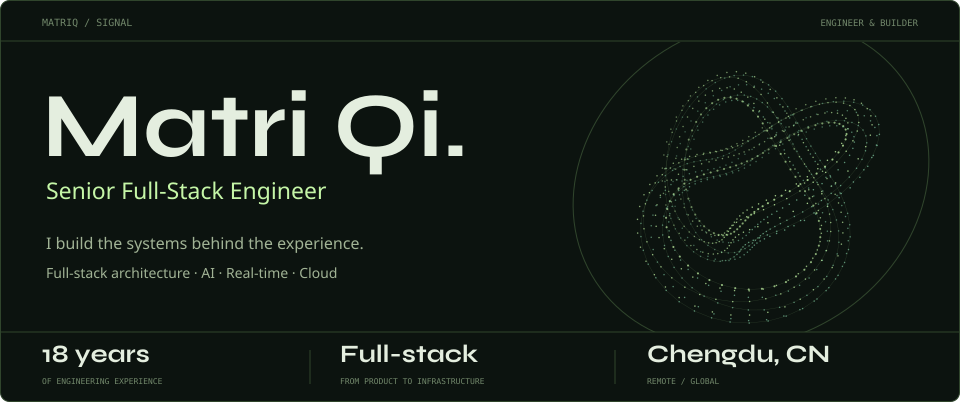
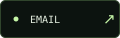
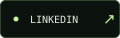
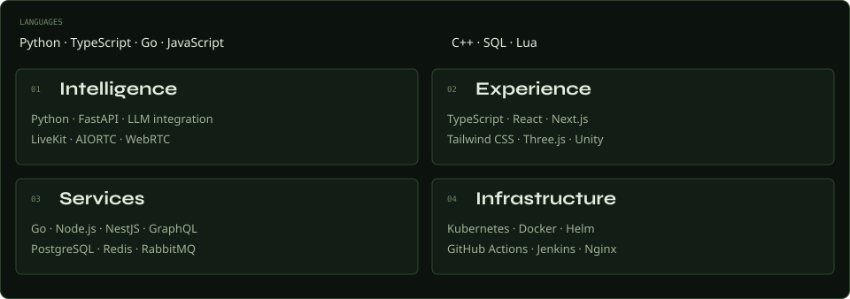
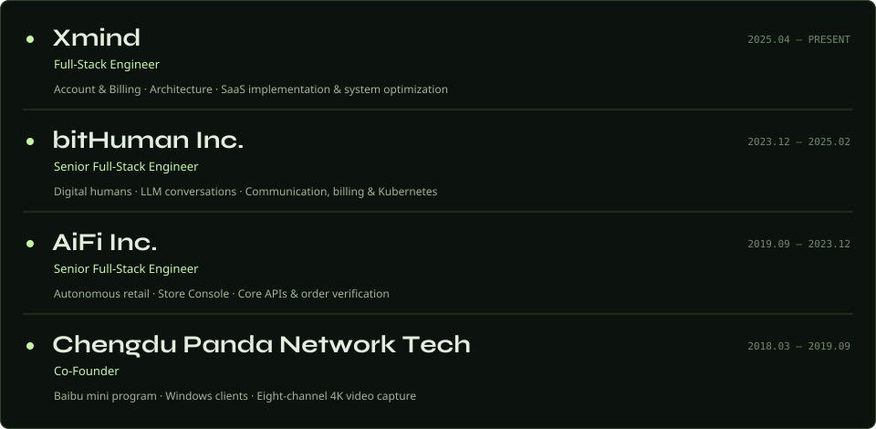
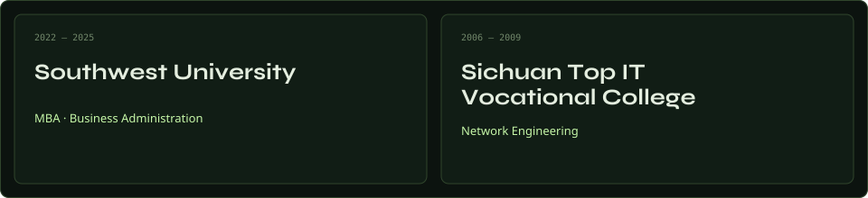
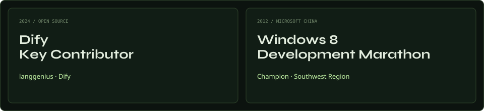
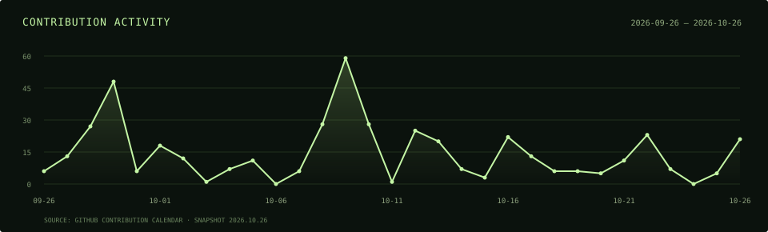
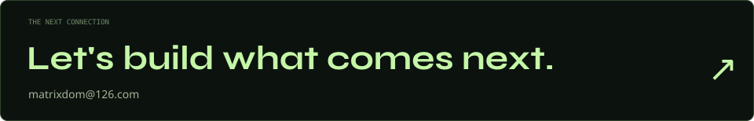

<picture>
  <source media="(prefers-color-scheme: light) and (max-width: 640px)" srcset="./assets/signal-hero-light-mobile.svg" />
  <source media="(prefers-color-scheme: light)" srcset="./assets/signal-hero-light.svg" />
  <source media="(max-width: 640px)" srcset="./assets/signal-hero-dark-mobile.svg" />
  
</picture>

<a href="mailto:matrixdom@126.com"><picture>
  <source media="(prefers-color-scheme: light)" srcset="./assets/signal-link-email-light.svg" />
  
</picture></a> &nbsp; <a href="https://linkedin.com/in/matriqi"><picture>
  <source media="(prefers-color-scheme: light)" srcset="./assets/signal-link-linkedin-light.svg" />
  
</picture></a> &nbsp; <a href="https://github.com/MatriQ"><picture>
  <source media="(prefers-color-scheme: light)" srcset="./assets/signal-link-github-light.svg" />
  
</picture></a>

<a href="#toolkit">Toolkit</a> &nbsp; / &nbsp; <a href="#professional-journey">Journey</a> &nbsp; / &nbsp; <a href="#education">Education</a> &nbsp; / &nbsp; <a href="#honors">Honors</a> &nbsp; / &nbsp; <a href="#activity">Activity</a>

**Deep in the stack. Focused on the human.**

I'm **Matri Qi**, a senior full-stack engineer with **18 years of experience**. Currently at **Xmind**, working on **Account & Billing**, architecture, SaaS implementation, and system optimization. My experience also spans digital humans, autonomous retail, and cloud-native infrastructure.

<b>Areas of specialization</b>

- Full-stack development and architecture
- AI/ML integration and digital humans
- Cloud-native infrastructure and Kubernetes orchestration
- Real-time systems and WebRTC
- Microservices and distributed systems

<h2>
<picture>
  <source media="(prefers-color-scheme: light) and (max-width: 640px)" srcset="./assets/signal-section-toolkit-light-mobile.svg" />
  <source media="(prefers-color-scheme: light)" srcset="./assets/signal-section-toolkit-light.svg" />
  <source media="(max-width: 640px)" srcset="./assets/signal-section-toolkit-dark-mobile.svg" />
  
</picture>
</h2>

<picture>
  <source media="(prefers-color-scheme: light) and (max-width: 640px)" srcset="./assets/signal-toolkit-light-mobile.svg" />
  <source media="(prefers-color-scheme: light)" srcset="./assets/signal-toolkit-light.svg" />
  <source media="(max-width: 640px)" srcset="./assets/signal-toolkit-dark-mobile.svg" />
  
</picture>

<b>Explore the full toolkit</b>

**Languages:** Python, TypeScript, Go, JavaScript, C++, SQL, Lua 
**Frontend:** React, Next.js, Three.js, Tailwind CSS, Redux, HTML, CSS, Sass 
**Backend:** Node.js, NestJS, FastAPI, Flask, Express, GraphQL, Prisma, RabbitMQ 
**Cloud & DevOps:** Kubernetes, Docker, Helm, Jenkins, GitHub Actions, Nginx, Linux, Bash 
**Data:** PostgreSQL, MySQL, MongoDB, Redis, Elasticsearch 
**Game & 3D:** Unity, Three.js, Blender

<h2>
<picture>
  <source media="(prefers-color-scheme: light) and (max-width: 640px)" srcset="./assets/signal-section-journey-light-mobile.svg" />
  <source media="(prefers-color-scheme: light)" srcset="./assets/signal-section-journey-light.svg" />
  <source media="(max-width: 640px)" srcset="./assets/signal-section-journey-dark-mobile.svg" />
  
</picture>
</h2>

<picture>
  <source media="(prefers-color-scheme: light) and (max-width: 640px)" srcset="./assets/signal-journey-light-mobile.svg" />
  <source media="(prefers-color-scheme: light)" srcset="./assets/signal-journey-light.svg" />
  <source media="(max-width: 640px)" srcset="./assets/signal-journey-dark-mobile.svg" />
  
</picture>

<b>Xmind — Full-Stack Engineer</b> · Apr 2025–Present

- Maintain and develop Account &amp; Billing services.
- Design system architecture.
- Implement SaaS solutions.
- Optimize systems.

<b>bitHuman Inc. — Senior Full-Stack Engineer</b>

- Architected digital human systems with communication and billing modules.
- Developed agent generation and LLM-powered conversation systems.
- Established frontend code review practices.
- Deployed scalable Kubernetes infrastructure with Helm.

**Tech stack:** AIORTC · LiveKit · Next.js · Tailwind CSS · FastAPI · Kubernetes · PostgreSQL · Redis

<b>AiFi Inc. — Senior Full-Stack Engineer</b>

- Built Store Console for unmanned store calibration and data management.
- Implemented Store API and CoreAPI for business services.
- Created human assistance tools for order verification.
- Delivered end-to-end solutions from backend to frontend.

**Tech stack:** Unity3D · Python · .NET · gRPC · Kubernetes · NestJS · TypeScript · TypeORM · Go

<b>Chengdu Panda Network Tech — Co-Founder</b>

- Built the Baibu WeChat Mini Program from the ground up.
- Developed a Windows cloud disk client using C++ and shell integration.
- Implemented an eight-channel 4K video capture system.
- Led technical direction and product development.

**Tech stack:** Express · JavaScript · C++ · Windows

<h2>
<picture>
  <source media="(prefers-color-scheme: light) and (max-width: 640px)" srcset="./assets/signal-section-education-light-mobile.svg" />
  <source media="(prefers-color-scheme: light)" srcset="./assets/signal-section-education-light.svg" />
  <source media="(max-width: 640px)" srcset="./assets/signal-section-education-dark-mobile.svg" />
  
</picture>
</h2>

<picture>
  <source media="(prefers-color-scheme: light) and (max-width: 640px)" srcset="./assets/signal-education-light-mobile.svg" />
  <source media="(prefers-color-scheme: light)" srcset="./assets/signal-education-light.svg" />
  <source media="(max-width: 640px)" srcset="./assets/signal-education-dark-mobile.svg" />
  
</picture>

<h2>
<picture>
  <source media="(prefers-color-scheme: light) and (max-width: 640px)" srcset="./assets/signal-section-honors-light-mobile.svg" />
  <source media="(prefers-color-scheme: light)" srcset="./assets/signal-section-honors-light.svg" />
  <source media="(max-width: 640px)" srcset="./assets/signal-section-honors-dark-mobile.svg" />
  
</picture>
</h2>

<picture>
  <source media="(prefers-color-scheme: light) and (max-width: 640px)" srcset="./assets/signal-honors-light-mobile.svg" />
  <source media="(prefers-color-scheme: light)" srcset="./assets/signal-honors-light.svg" />
  <source media="(max-width: 640px)" srcset="./assets/signal-honors-dark-mobile.svg" />
  
</picture>

[Dify / langgenius ↗](https://github.com/langgenius/dify)

<b>Earlier recognition · 2008 / 2007</b>

- **Chengdu International Software Competition** — Outstanding Contestant · November 2008
- **Sichuan Provincial Computer Competition** — Second Prize · July 2008
- **Chengdu International Software Development Competition** — Outstanding Contestant · 2007

<h2>
<picture>
  <source media="(prefers-color-scheme: light) and (max-width: 640px)" srcset="./assets/signal-section-activity-light-mobile.svg" />
  <source media="(prefers-color-scheme: light)" srcset="./assets/signal-section-activity-light.svg" />
  <source media="(max-width: 640px)" srcset="./assets/signal-section-activity-dark-mobile.svg" />
  
</picture>
</h2>

<picture>
  <source media="(prefers-color-scheme: light)" srcset="./assets/signal-contribution-activity-light.svg" />
  
</picture>

<picture>
  <source media="(prefers-color-scheme: light)" srcset="./assets/signal-contribution-snake-light.svg" />
  
</picture>

Contribution snapshot · October 26, 2026

<a href="mailto:matrixdom@126.com"><picture>
  <source media="(prefers-color-scheme: light) and (max-width: 640px)" srcset="./assets/signal-footer-light-mobile.svg" />
  <source media="(prefers-color-scheme: light)" srcset="./assets/signal-footer-light.svg" />
  <source media="(max-width: 640px)" srcset="./assets/signal-footer-dark-mobile.svg" />
  
</picture></a>

THOUGHTFULLY ENGINEERED. ALWAYS EVOLVING.

